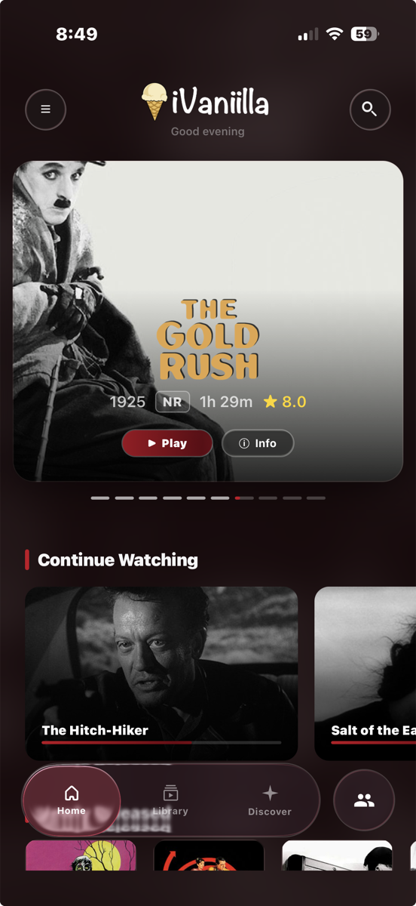
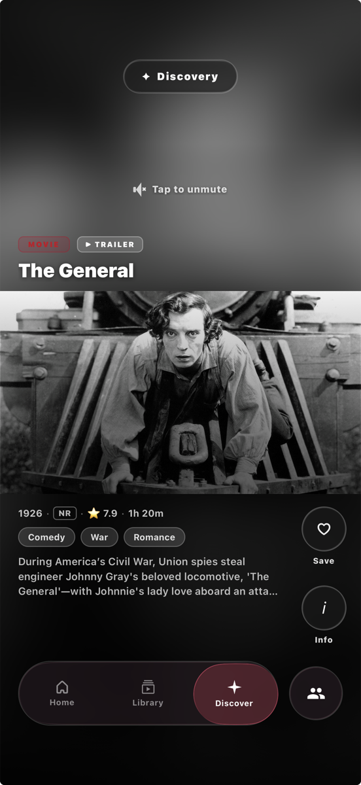
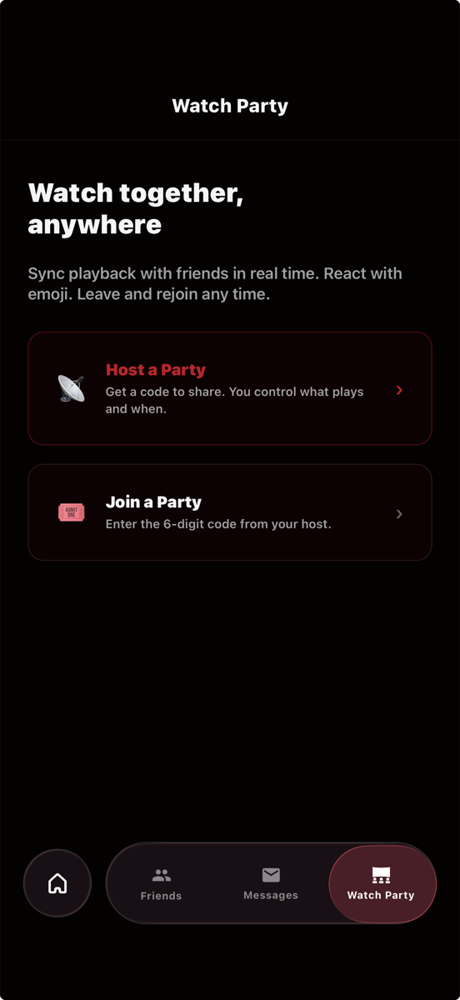

# JellyStream

A polished iPhone and iPad streaming app for self-hosted [Jellyfin](https://jellyfin.org) media servers, with a
companion Node.js server that adds the social features Jellyfin doesn't have: friends, messaging, watch
parties and push notifications. Shipped to real users through TestFlight.

**TypeScript · React Native (New Architecture) · Node.js · WebSockets · SQLite · APNs · XCUITest**

  
  &nbsp;
  
  &nbsp;
  

> The source code is in a private repository. I'm happy to walk through it or share access for interviews.
> Contact me through my GitHub profile.

## What it does

**Watching**
- Apple TV–inspired home screen with a featured carousel, Continue Watching and per-library rows.
- Discovery feed with autoplaying trailers and "More Like This" recommendations.
- Full-featured player: resume, automatic intro/recap skipping with Undo, Up Next countdown,
  "Are you still watching?", and remembered audio and subtitle choices.
- **Watch Party:** synchronized playback with friends, with live emoji reactions.

**Offline**
- Downloads in original quality or as server-transcoded 1080p/720p copies.
- Smart Downloads keeps your next episodes ready on Wi-Fi and cleans up watched ones.

**Social**
- Friends via invite links or friend codes, direct messages, shareable links and push notifications.
- Users can request new movies and shows from inside the app.

**Platform**
- Adaptive iPhone and iPad layouts, iOS 26 Liquid Glass with fallbacks for older iOS, keyboard shortcuts
  and haptics.

## Technical highlights

- **Full stack, built solo:** ~29k lines of TypeScript in the app (20 screens, 26 services) and a 1,750-line
  Node.js relay server handling REST, WebSockets, SQLite storage and Apple push notifications over HTTP/2.
- **Security-minded networking:** at home the app switches to a faster direct LAN connection, but only after
  verifying the server's identity through an unauthenticated endpoint. It never sends credentials to an
  unverified device that happens to share a common private IP.
- **Real-time sync:** watch parties build on Jellyfin's SyncPlay protocol, and one WebSocket carries presence,
  friends and messages through an internal event bus instead of each screen polling.
- **Resource-aware downloads:** a pure, testable scheduler caps concurrent downloads and server transcodes, so
  queueing a whole season doesn't overload the media server.
- **Minimal dependencies on the server:** built on Node's own `node:sqlite` and `http2` modules, with one npm
  package (`ws`).
- **Automated UI testing:** XCUITest smoke tests (launch, playback, offline mode, season downloads) run against
  a mock Jellyfin server as part of an automated nightly workflow.
- **Migrated to React Native's New Architecture** while keeping the app shippable.

## Status

In active development, with 110+ commits. Used daily and distributed to testers through TestFlight.

---

© 2026 vaniilla9. All rights reserved. Screenshots show public-domain films.
